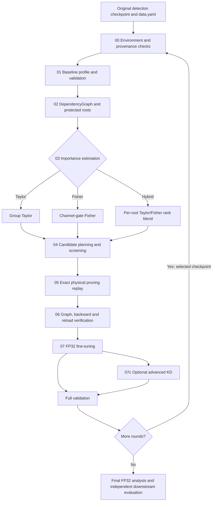

# Dependency-Aware Structured Pruning and FP32 Recovery for YOLO

A research-oriented pipeline for **physically removing redundant channels from YOLO object detectors**, verifying the resulting architecture, and recovering detection accuracy with supervised fine-tuning and optional knowledge distillation.

The pipeline combines dependency-aware graph analysis, **Group Taylor**, **empirical channel-gate Fisher**, and **hybrid channel scoring** with candidate screening, structural checks, and progressive pruning rounds. It is designed to make the trade-off between model size and detection quality **measurable and reproducible**, not to promise a particular compression ratio or hardware speedup.

> **Scope:** FP32 structured pruning and recovery of Ultralytics YOLO detection models. Quantization-aware training (QAT), post-training quantization (PTQ), ONNX-to-TFLite conversion, INT8 deployment, and final device-specific performance certification are separate workflows.
>
> **Validation status:** The algorithms and commands below describe the supplied pruning documentation. Passing individual stage checks does not establish that every model family, compression target, or deployment device has been tested successfully. See [Validation and limitations](#12-validation-and-limitations).

## Contents

1. [Overview](#1-overview)
2. [Architecture and repository layout](#2-architecture-and-repository-layout)
3. [Pruning and recovery methods](#3-pruning-and-recovery-methods)
4. [Requirements and installation](#4-requirements-and-installation)
5. [Model and dataset preparation](#5-model-and-dataset-preparation)
6. [Run progressive experiments](#6-run-progressive-experiments)
7. [Run individual stages](#7-run-individual-stages)
8. [Configuration and tuning](#8-configuration-and-tuning)
9. [Artifacts and validation gates](#9-artifacts-and-validation-gates)
10. [Evaluation and comparisons](#10-evaluation-and-comparisons)
11. [Troubleshooting](#11-troubleshooting)
12. [Validation and limitations](#12-validation-and-limitations)
13. [Reproducibility and Git](#13-reproducibility-and-git)
14. [References](#14-references)

---

## 1. Overview

### 1.1. Objectives

Structured channel pruning reduces the **actual dimensions** of convolutional filters, their dependent input channels, normalization parameters, and coupled tensors. Unlike setting individual weights to zero, successful structural pruning produces a smaller, reloadable model with fewer physical parameters and potentially fewer multiply–accumulate operations (MACs).

The workflow is built around five concerns:

1. **Structural safety:** use Torch-Pruning's `DependencyGraph` to determine which tensors must change together; protect fragile head, attention, and split-related paths.
2. **Importance estimation:** assess candidate channels using real detection-loss gradients and optional feature perturbation tests.
3. **Controlled compression:** verify planned changes on a disposable model, then replay the exact operations on the persistent model.
4. **Accuracy recovery:** retrain the pruned topology without rebuilding the original full-width network, with optional teacher–student losses.
5. **Experiment integrity:** use stage gates, artifact hashes, independent reload checks, and a consistent validation protocol.

### 1.2. Supported architectural scope

The common pruning metadata describes the following Ultralytics *detection* families:

| Family | Declared scales | Architecture-specific concerns |
|---|---|---|
| YOLOv8 | `n`, `s`, `m`, `l` | C2f/CSP connections, detection head and DFL-related dependencies |
| YOLO11 | `n`, `s`, `m`, `l` | C3k2/C2PSA, head and attention-sensitive dependencies |
| YOLO26 | `n`, `s`, `m`, `l` | One-to-many/one-to-one heads, attention and static split paths |

**Declared family support is not a tested compatibility matrix.** Each checkpoint must pass the environment, graph, gradient, structural, and reload checks. The progressive experiment configuration below uses a **YOLO26n head/person detector** as its concrete example; adapting it to other models requires checking architecture assumptions and command-line contracts.

### 1.3. End-to-end workflow



A single planning run can include several candidate decisions; an actual **progressive round** is the complete sequence of pruning, structural verification, recovery, validation, and rescore before another pruning pass. These are different concepts.

---

## 2. Architecture and repository layout

Keep the numbered Python stages and shared modules together. The expected layout for the documented experiment entry points is:

```text
dependency-aware-pruning/
├── README.md
├── 00_check_environment.py
├── 01_profile_baseline.py
├── 02_analyze_pruning_graph.py
├── 03_collect_gradient_importance.py
├── 03b_collect_group_fisher.py
├── 03c_collect_hybrid_importance.py
├── 04_plan_structured_pruning.py
├── 04b_plan_accuracy_aware.py
├── 05_apply_structured_pruning.py
├── 06_verify_pruned_model.py
├── 07_recover_fp32.py
├── 07b_recovery_fp32_kd.py
├── 07c_recovery_fp32_kd_advanced.py
├── pruning_common.py
├── dataset_legacy_bridge.py
├── pruning_runs.bash
├── run_taylor.sh
├── run_fisher.sh
└── run_hybrid.sh
```

The script filenames are significant. Some stages load sibling Python modules by filename; renaming individual files can break imports or provenance contracts.

### 2.1. Source file reference

| File | Responsibility |
|---|---|
| `pruning_common.py` | Shared dataset/model metadata, run contracts, SHA256 hashing, stage gates, environment snapshots and common utilities |
| `dataset_legacy_bridge.py` | Narrow, explicit handling of certain historical dataset inventory records; it does not prove historical dataset contents |
| `00_check_environment.py` | Validate checkpoint, dataset, device, model family, forward behavior, and initial provenance |
| `01_profile_baseline.py` | Profile parameters/MACs, record baseline graph and validation metrics |
| `02_analyze_pruning_graph.py` | Trace dependency groups, classify eligible/protected roots, probe graph safety |
| `03_collect_gradient_importance.py` | Compute coupled Group Taylor channel scores from training-loss gradients |
| `03b_collect_group_fisher.py` | Compute empirical channel-gate Fisher scores or a hybrid Taylor/Fisher ranking |
| `03c_collect_hybrid_importance.py` | Select the hybrid scoring mode using the shared Fisher-capable implementation |
| `04_plan_structured_pruning.py` | Plan and validate ordered dependency-safe channel removals using scratch-model pruning |
| `04b_plan_accuracy_aware.py` | Add train-image feature-reconstruction screening and optional original-layer pruning caps |
| `05_apply_structured_pruning.py` | Replay the approved plan as permanent physical channel removal and save a checkpoint |
| `06_verify_pruned_model.py` | Audit topology, gradients, parameter changes, fresh-process reload, and pre-recovery validation |
| `07_recover_fp32.py` | Fine-tune while preserving the reduced model topology and save best/last FP32 checkpoints |
| `07b_recovery_fp32_kd.py` | Optional attention-transfer distillation experiment |
| `07c_recovery_fp32_kd_advanced.py` | Optional attention, classification, and localization distillation experiment |
| `pruning_runs.bash` | Shared orchestration of progressive rounds, mode selection, checkpoint lineage and validation |
| `run_taylor.sh` | Run progressive Group Taylor experiments |
| `run_fisher.sh` | Run progressive empirical gate-Fisher experiments |
| `run_hybrid.sh` | Run progressive hybrid-ranking experiments |

**Compatibility contract:** The Fisher/hybrid scoring paths emit the downstream Stage 03 gate/artifact schema; the screened planner emits the Stage 04 schema. Stage 05 still consumes a normal approved pruning plan, and Stage 06 still performs an independent structural verification. The alternative score or planner must not bypass these gates.

---

## 3. Pruning and recovery methods

### 3.1. Dependency-aware physical pruning

Removing a channel from a convolution can require coordinated changes to downstream convolution inputs, normalization dimensions, residual operations, concatenations and other connected nodes. Torch-Pruning's `DependencyGraph` provides coupled operations for a candidate root.

Stage 02 identifies safe candidate roots while protecting operations that are not reliably handled by the corresponding trace or structural policy. The protection policy includes detection-head output paths, attention-sensitive components, and certain static split/chunk dependencies. An eligible root is **not automatically safe for every channel combination**: planning and replay perform further checks.

Stage 04 applies candidates to disposable model copies, checks the forward pass, and measures resulting parameter/MAC changes. Stage 05 replays the exact approved indices on the real model. Stage 06 independently checks physical dimensions, graph consistency, forward/backward execution and checkpoint reloadability.

### 3.2. Group Taylor importance

The Taylor scorer accumulates first-order weight–gradient contributions from the native YOLO detection loss on training mini-batches. In simplified notation,

\[
S_{\mathrm{Taylor}}(g,c) \approx
\mathbb{E}_{b}\left[
\sum_{p\in\mathcal{D}(g,c)}
\left|w_p\frac{\partial(\mathcal{L}_b/B_b)}{\partial w_p}\right|
\right],
\]

where \(\mathcal{D}(g,c)\) denotes the unique coupled parameter elements associated with channel \(c\) of pruning root \(g\), and \(B_b\) denotes the batch-size normalization used by the scoring procedure.

Dependency mappings must be resolved and repeated parameter contributions deduplicated. Lower scores indicate a *candidate* for removal, not a guarantee of negligible mAP loss.

### 3.3. Empirical channel-gate Fisher importance

For a conceptual multiplicative gate \(z_c\) placed on the output of a root convolution, the Fisher-style score is based on squared derivatives:

\[
S_{\mathrm{Fisher}}(g,c) =
\mathbb{E}_{b}\left[
\left(\frac{\partial \mathcal{L}_b}{\partial z_c}\right)^2
\right].
\]

The gate score measures sensitivity of the root's activation channel; `DependencyGraph` determines the coupled physical changes necessary to remove that channel. This is an **empirical multiplicative-gate approximation**. It is not a claim to implement a full Fisher matrix inverse or every step of the published Group Fisher algorithm.

### 3.4. Hybrid Taylor–Fisher ranking

The hybrid mode uses **within-root percentile ranks**, rather than summing raw Taylor and Fisher magnitudes on incompatible scales. Its ranking combines Taylor and Fisher with a configurable Fisher weight `BLEND_ALPHA` (default `0.5`); the Taylor share is `1 - BLEND_ALPHA`.

The hybrid result is a heuristic ranking criterion, not a statistically calibrated estimate of expected mAP loss. To compare it fairly, hold the planner, recovery schedule, target budget, dataset and validation protocol constant across modes.

**Artifact field caveat:** The scorer may reuse the compatibility field `score_mean_abs_taylor` in Stage 03 output files even when the active score is Fisher or hybrid. Read the stage configuration (`importance_method` and `blend_alpha`) and the explicit `score_original_taylor`/`score_gate_fisher` columns; do not infer the scoring method from the compatibility field name alone.

### 3.5. Accuracy-aware candidate screening

The screening planner uses training images to estimate the effect of temporarily masking candidate channel blocks on **features before the detection head**. It screens a small group of promising candidates and blends the resulting ranking with the importance criterion.

- Candidate masking is temporary; **it is not the final pruning operation**.
- The perturbation signal is a **feature-reconstruction proxy**, not validation mAP.
- Candidates still undergo dependency-aware structural simulation and resource checks.
- Optional per-layer caps constrain the cumulative fraction removed relative to an original/reference checkpoint.
- The planner may fail if no safe plan meets the configured target and partial attainment is not allowed.

The documented screening configuration considers blocks of 8 eligible channels, normally checks 2 deterministic training images, screens 6 highly ranked candidates, and uses a screening weight of `0.65`. These are experiment settings, not universal architectural requirements.

### 3.6. Recovery and knowledge distillation

**Standard FP32 recovery** uses the native Ultralytics detection training machinery while keeping the physically reduced network intact. It is not equivalent to reloading a YAML description of the original full-width model and calling a generic trainer that might reconstruct the original architecture.

Two optional teacher–student objectives are documented:

- **Attention transfer:** encourage student feature-map attention patterns at three head-input scales to resemble those of a frozen teacher.
- **Advanced distillation:** add soft classification-target matching and foreground-weighted raw-box localization matching to the attention objective. The documented approach uses Bernoulli/KL-style classification matching and Smooth L1-style regression matching.

The student continues to optimize the native detection loss. Distillation weights should be treated as experimental hyperparameters. The teacher must have matching class semantics, and feature/raw-head interfaces must be validated rather than guessed.

Knowledge distillation does not restore removed channels or add inference-time parameters to the student by design. Successful completion of a recovery stage is not proof that original mAP has been restored.

---

## 4. Requirements and installation

### 4.1. Dependencies

Use a Python environment compatible with the specific Ultralytics, PyTorch and Torch-Pruning versions under evaluation. The pruning scripts depend on their runtime APIs; a successful import alone does not guarantee architectural compatibility.

Typical requirements include:

- Python 3.10 or newer.
- PyTorch and a matching `torchvision` build (CPU or compatible NVIDIA CUDA).
- Ultralytics and Torch-Pruning with `DependencyGraph` and profiling utilities.
- NumPy, PyYAML, Pillow and supporting model/dataset packages.
- Sufficient RAM/VRAM for autograd tracing, detection-loss backward passes, scratch-model cloning and fine-tuning.

The project should be run in the **same validated environment** when comparing importance methods. Avoid upgrading model or pruning libraries midway through a controlled experiment.

### 4.2. Example Linux environment

```bash
python3 -m venv .venv
source .venv/bin/activate
python -m pip install --upgrade pip

# Install the matching PyTorch/torchvision build for the local CPU/CUDA system first.
# Then install the remaining dependencies:
python -m pip install ultralytics torch-pruning numpy pyyaml pillow thop

# Optional: only for Stage 06's ONNX export check.
python -m pip install onnx
```

Check the environment:

```bash
python - <<'PY'
import torch
import ultralytics
import torch_pruning as tp
import yaml

print('PyTorch:', torch.__version__)
print('Ultralytics:', ultralytics.__version__)
print('CUDA available:', torch.cuda.is_available())
print('CUDA devices:', torch.cuda.device_count())
print('Torch-Pruning profiler:',
      callable(getattr(tp.utils, 'count_ops_and_params', None)))
print('PyYAML:', yaml.__version__)
PY
```

Check script syntax and discover supported arguments from the actual checkout:

```bash
python -m compileall -q .
for f in run_taylor.sh run_fisher.sh run_hybrid.sh pruning_runs.bash; do
  bash -n "$f"
done
python 03b_collect_group_fisher.py --help
python 04b_plan_accuracy_aware.py --help
```

Python syntax checks do not run GPU forward/backward operations or certify experiment results.

---

## 5. Model and dataset preparation

### 5.1. Model checkpoint

Use a trusted, trained Ultralytics **detection** checkpoint (`.pt`) as the original source. Subsequent rounds start from the selected recovered checkpoint of the previous round, but cumulative compression must always be measured relative to the same original reference model.

PyTorch checkpoint loading can use pickle serialization; do not load untrusted `.pt` files.

### 5.2. Dataset

An example two-class YOLO dataset definition:

```yaml
path: /absolute/path/to/head_and_person_dataset
train: images/train
val: images/val
test: images/test
nc: 2
names:
  0: head
  1: person
```

Labels use the standard YOLO detection format:

```text
class_id center_x center_y width height
```

Bounding-box coordinates are normalized to `[0, 1]`. Verify that image and label directories align, that class indices are stable, and that the training/validation/test splits have not been contaminated by duplicates or accidental overlap.

The progressive experiment uses **training data** for gradient scores and feature screening; it uses **validation data** to choose recovered checkpoints. Reserve the independent **test split** for final frozen-model reporting, not method selection.

### 5.3. Experimental identity

For controlled Taylor/Fisher/hybrid comparisons, keep the following fixed:

- Original checkpoint bytes and SHA256.
- Dataset manifest, YAML, class mapping, splits and image preprocessing.
- Evaluation implementation, confidence floor, NMS IoU, maximum detections and head mode.
- Graph protection settings, target definition, planner/screening budget and recovery schedule.
- Software versions and device configuration where practical.

A stage's run contract can include model, YAML, run directory, image size, device, batch, worker count, family and expected number of classes. Do not change these between dependent steps of one round.

---

## 6. Run progressive experiments

The recommended high-level entry points are:

| Command | Channel scoring | Planning and recovery |
|---|---|---|
| `bash ./run_taylor.sh` | Group Taylor | Screened planning → physical pruning → FP32 recovery → advanced KD → full validation |
| `bash ./run_fisher.sh` | Empirical channel-gate Fisher | Same structural and recovery path |
| `bash ./run_hybrid.sh` | Per-root Taylor/Fisher rank blend | Same structural and recovery path |

These three runs should use independent output directories. Run them sequentially unless GPU allocation has explicitly been planned to prevent out-of-memory failures.

### 6.1. Configure the experiment

The following paths reflect an **example server layout** and must be checked on the target machine:

```bash
cd /mnt/hdd/dev/edgeAI/chienvt
source .venv/bin/activate
cd /absolute/path/to/dependency-aware-pruning

export ROOT=/mnt/hdd/dev/edgeAI/chienvt
export ORIGINAL="$ROOT/head_and_person_training/runs/head_person_fp32/yolo26n_adamw_e100/weights/best.pt"
export DATA="$ROOT/head_and_person_dataset_clean/data.yaml"
export OUT_ROOT="$ROOT/dependency_aware_prunning/runs/progressive_accuracy_v2"

export DEVICE=0
export CONTRACT_BATCH=4
export WORKERS=4
export GRAD_MB=2
export GRADIENT_BATCHES=64
export RECOVERY_EPOCHS=35
export KD_EPOCHS=15

ls -lh "$ORIGINAL" "$DATA"
```

The checkout path is an example: run commands from the directory containing the pruning shell entry points and numbered Python files. The output directory is independent of the source checkout.

### 6.2. Safe preflight: stop before physical pruning

```bash
export STOP_AFTER_PLAN=1
export LIMIT_ROUNDS=1
bash ./run_taylor.sh
```

This tests the preliminary pipeline through candidate planning for the first Taylor round, without persisting a physically pruned checkpoint. Inspect the plan and its gate:

```bash
python -m json.tool \
  "$OUT_ROOT/taylor/round_01/gates/04_plan_structured_pruning.json"
python -m json.tool \
  "$OUT_ROOT/taylor/round_01/stages/04/04_plan.json"
```

A `PASS` gate only means the mandatory checks for that stage succeeded. Inspect the **actual planned reduction** and decision list before proceeding.

### 6.3. Complete the experiment

```bash
export STOP_AFTER_PLAN=0
export LIMIT_ROUNDS=4
bash ./run_taylor.sh
```

For independent comparisons:

```bash
bash ./run_taylor.sh
bash ./run_fisher.sh
bash ./run_hybrid.sh
```

For a more economical initial sweep, set `LIMIT_ROUNDS=1`, run all three modes through one recovery round, compare their full-validation summaries, and only then continue the candidates worth evaluating across all planned rounds.

### 6.4. Progressive targets and model selection

The documented study proposes cumulative physical FP32 parameter reductions of approximately **15%, 30%, 40% and at least 50%** across four distinct rounds. These percentages are *targets*, not reported achieved results.

For each round:

1. Construct a new run contract with the selected input checkpoint.
2. Build a fresh dependency graph and collect new importance scores.
3. Plan and verify candidate removal, then physically prune and independently audit.
4. Perform standard FP32 recovery and optional advanced KD.
5. Evaluate eligible recovered checkpoints on the **full validation split**.
6. Select the checkpoint for the next round according to the experiment's validation criteria.
7. Record the new physical parameter count relative to the original reference, not merely the previous round.

The documented shell workflow checks the final parameter-count target rather than silently marking a substantially smaller reduction as success. It also reports Precision, Recall and mAP50–95 changes against a freshly evaluated original reference. A reported `three_metrics_within_3pp` flag should be read as a **measurement against the specified protocol**, not as proof of INT8 performance.

---

## 7. Run individual stages

Manual execution is useful for debugging, controlled ablations, and understanding stage outputs. It does **not** automatically implement multiple prune/recover/rescore rounds. The commands below describe a single round using the Group Taylor scorer and the standard planner. The alternative scorer and screened planner produce compatible downstream artifact contracts; consult their `--help` output and the progressive entry points for their specific argument combinations.

### 7.1. Common arguments

```bash
cd /path/to/dependency-aware-pruning
source /path/to/.venv/bin/activate

export MODEL=/absolute/path/to/trained_best.pt
export DATA=/absolute/path/to/data.yaml
export RUN=/absolute/path/to/runs/pruning/round_01

COMMON=(
  --model "$MODEL"
  --data "$DATA"
  --output "$RUN"
  --imgsz 640
  --device 0
  --batch 8
  --workers 4
  --family auto
  --expected-classes 2
)
```

Keep `COMMON` consistent across Stages 00–07 within the round. The `--model` value is the **round's input** checkpoint. Stage 05/06/07 locate internally generated artifacts through the run's provenance and should not be pointed at arbitrary replacements halfway through a round.

### 7.2. Stage 00 — Environment and input validation

```bash
python 00_check_environment.py "${COMMON[@]}"
```

Checks environment availability, dataset/class metadata, model identity and a finite forward pass. The initial gate is written under `gates/00_check_environment.json`.

### 7.3. Stage 01 — Baseline profile

```bash
python 01_profile_baseline.py "${COMMON[@]}" \
  --conf 0.001 --iou 0.7 --max-det 1000 \
  --profile-repeats 2 --warmup-iters 2 --bench-iters 5
```

Records parameter count, MACs, nominal FLOPs, module inventory and validation metrics. It also records reference inference timing, which must **not** be presented as target-device latency.

### 7.4. Stage 02 — Dependency graph feasibility

```bash
python 02_analyze_pruning_graph.py "${COMMON[@]}" \
  --channel-align 8 --min-channels 16 --trace-mode train
```

Builds the dependency graph and records eligible and protected pruning roots. The example uses 8-channel alignment and a minimum width of 16 for eligible feature channels; these do **not** imply that all YOLO layers or hardware backends require such widths.

### 7.5. Stage 03 — Group Taylor importance

```bash
python 03_collect_gradient_importance.py "${COMMON[@]}" \
  --gradient-batches 64 --gradient-batch-size 2 --seed 42
```

Computes sensitivity from real training-loss gradients without optimizer updates. The gradient microbatch can be smaller than the contract batch. Fisher and hybrid alternatives share the expected Stage 03 artifacts and must be selected explicitly when those methods are being tested.

### 7.6. Stage 04 — Structured pruning plan

```bash
python 04_plan_structured_pruning.py "${COMMON[@]}" \
  --method group-taylor \
  --target-metric params \
  --target-reduction 0.15 \
  --target-tolerance 0.005 \
  --channel-align 8 --min-channels 16 \
  --iterative-steps 1 --max-decisions 64 \
  --ranking sensitivity --candidate-mode hybrid
```

Simulates candidate changes on temporary model copies and records an exact replayable plan. For feature-aware screening, use `04b_plan_accuracy_aware.py` with its documented options; avoid assuming all options of the two planners are interchangeable.

A planning stage is not an accuracy gate: its score and perturbation proxy do not replace post-pruning validation.

### 7.7. Stage 05 — Physical pruning

```bash
python 05_apply_structured_pruning.py "${COMMON[@]}" \
  --channel-align 8 --min-channels 16 --profile-every 1
```

Replays the approved plan without re-ranking channels. The expected persistent checkpoint is:

```text
$RUN/stages/05/05_pruned_raw.pt
```

### 7.8. Stage 06 — Independent verification

```bash
python 06_verify_pruned_model.py "${COMMON[@]}" \
  --backward-batches 2 --backward-batch-size 2 \
  --val-max-images 256 --val-seed 42 \
  --compare-source-val --recovery-map-drop 0.02
```

Rechecks graph structure, Conv/BN dimensions, train-loss backward behavior, fresh-process checkpoint reload, and validation on the same subset as the input checkpoint. Set `--val-max-images 0` for full validation.

A structural `PASS` and an accuracy result such as `RECOVERY_NEEDED` can coexist; the latter is not evidence of graph corruption.

### 7.9. Stage 07 — Standard FP32 recovery

```bash
python 07_recover_fp32.py "${COMMON[@]}" \
  --recovery-epochs 30 --recovery-batch 4 \
  --recovery-workers 2 \
  --optimizer AdamW --lr0 0.0002 --lrf 0.05 \
  --weight-decay 0.0005 --patience 15 \
  --val-subset full --no-amp
```

Trains the already-pruned model using native detection loss while checking that the smaller topology survives training and checkpoint serialization. Expected outputs:

```text
$RUN/weights/pruned_recovered_best.pt
$RUN/weights/pruned_recovered_last.pt
```

### 7.10. Optional attention-transfer KD

```bash
python 07b_recovery_fp32_kd.py \
  --parent-round "$RUN" \
  --student "$RUN/weights/pruned_recovered_best.pt" \
  --teacher "$MODEL" \
  --data "$DATA" \
  --output "${RUN}_kd" \
  --epochs 30 --batch 4 --workers 4 \
  --kd-weight 0.2 --lr0 0.0001 --lrf 0.1 \
  --device 0
```

This is a separate experiment; it must not overwrite the standard recovery result. The teacher and student need compatible class labels and feature resolutions. The advanced `07c_recovery_fp32_kd_advanced.py` workflow is included in the progressive experiment orchestrator; its detailed CLI must be confirmed with its own `--help` before standalone invocation.

---

## 8. Configuration and tuning

### 8.1. Progressive experiment variables

These are the documented defaults for the three progressive entry points. Export a variable before launching a shell script to override a supported setting.

| Environment variable | Default | Meaning |
|---|---:|---|
| `GRADIENT_BATCHES` | `64` | Training microbatches used for importance estimation |
| `GRAD_MB` | `2` | Gradient microbatch size |
| `MAX_DECISIONS` | `128` | Upper bound on accepted pruning decisions per round |
| `SCREEN_IMAGES` | `2` | Training images used in feature perturbation screening |
| `SCREEN_TOP_K` | `6` | Viable candidates to screen at each decision |
| `SCREEN_WEIGHT` | `0.65` | Relative influence of screening ranking |
| `MAX_ORIGINAL_CONV_RATIO` | `0.80` | General cumulative upper bound on removed original Conv channels |
| `LAYER_CAPS_JSON` | unset | Optional JSON file describing specific per-layer caps |
| `BLEND_ALPHA` | `0.5` | Fisher weight in hybrid scoring |
| `RECOVERY_EPOCHS` | `35` | Standard FP32 recovery epochs per round |
| `KD_EPOCHS` | `15` | Additional advanced KD epochs per round |
| `KD_WEIGHT` | `0.15` | Attention-transfer loss weight |
| `KD_CLASS_WEIGHT` | `0.05` | Soft classification KD loss weight |
| `KD_BOX_WEIGHT` | `0.05` | Localization KD loss weight |
| `LIMIT_ROUNDS` | `4` | Number of progressive rounds |
| `STOP_AFTER_PLAN` | `0` | Stop after planning when set to `1` |

A documented built-in cap policy additionally restricts early backbone-layer pruning (typically 35% removed) while allowing larger changes elsewhere (typically up to 80%). The effective limits depend on the selected architecture, reference model and optional overrides; they can prevent the model from reaching the requested global target.

### 8.2. Custom layer caps

Example JSON:

```json
{
  "default": 0.75,
  "rules": [
    {"pattern": "^model\\.(0|1|2)\\.", "max_fraction": 0.25},
    {"pattern": "^model\\.(15|16)\\.", "max_fraction": 0.40}
  ]
}
```

Set `export LAYER_CAPS_JSON=/absolute/path/to/caps.json`. Adjust regular expressions to actual module names; the example does not identify universally correct P3/P4/P5 layer numbers.

### 8.3. Standard planner options

| Option | Documented default | Function |
|---|---|---|
| `--target-metric` | `channels` | Target `channels`, `params`, or `macs` |
| `--target-reduction` | `0.10` | Desired fraction of the chosen resource to remove |
| `--target-tolerance` | `0.005` | Tolerance in target attainment |
| `--channel-align` | `8` | Eligible channel-block alignment |
| `--min-channels` | `16` | Minimum eligible feature-channel width |
| `--iterative-steps` | `5` | Logical planning steps *within* one pruning plan |
| `--max-decisions` | `64` | Maximum accepted decisions |
| `--ranking` | `sensitivity` | Sensitivity-first or efficiency-first selection |
| `--candidate-mode` | `hybrid` | Candidate search mode |
| `--allow-partial-target` | off | Permit an otherwise valid plan that misses the full target |
| `--max-original-conv-prune-ratio` | `1.0` | Optional cumulative per-Conv limit against a reference checkpoint |
| `--balance-strength` | `0.0` | Optional penalty for over-concentrating pruning in a root |
| `--normalize-sensitivity` | off | Optional sensitivity-score normalization |

When using a cumulative per-Conv limit less than `1.0` with the standard planner, the documented interface requires a reference checkpoint (`--reference-model`). For multi-round experiments, report both **per-round** and **cumulative** reductions.

### 8.4. Selection principles

- **Sensitivity-first ranking** prioritizes lower estimated damage; **efficiency-first ranking** considers resource savings as well.
- **Lower importance does not mean zero accuracy impact**; validate after physical pruning and recovery.
- **Fewer parameters do not imply proportional speedup**. MACs, memory behavior, operator support and target runtime must be measured separately.
- **8-channel alignment is a configured pruning constraint**, not a mathematical necessity for every model or chip. Change it only after verifying graph feasibility and updating dependent experiment settings consistently.
- Keep the detection head and fragile graph paths protected unless their pruning and replay safety are established by additional tests.

---

## 9. Artifacts and validation gates

### 9.1. Individual round outputs

A successfully executed round may produce the following files (some depend on selected flags and stages):

```text
$RUN/
├── gates/
│   ├── 00_check_environment.json
│   ├── 01_profile_baseline.json
│   ├── 02_analyze_pruning_graph.json
│   ├── 03_collect_gradient_importance.json
│   ├── 04_plan_structured_pruning.json
│   ├── 05_apply_structured_pruning.json
│   ├── 06_verify_pruned_model.json
│   └── 07_recover_fp32.json
├── stages/
│   ├── 00/00_environment.json
│   ├── 01/01_profile.json
│   ├── 01/01_baseline_val.json
│   ├── 02/02_graph.json
│   ├── 02/02_eligible_groups.csv
│   ├── 02/02_protected_groups.csv
│   ├── 03/03_importance.json
│   ├── 03/03_channel_scores.csv
│   ├── 03/03_grad_log.csv
│   ├── 04/04_plan.json
│   ├── 04/04_channel_changes.csv
│   ├── 05/05_pruned_raw.pt
│   ├── 05/05_report.json
│   ├── 05/05_graph_signature.json
│   ├── 05/05_pruning_trace.csv
│   ├── 06/06_report.json
│   ├── 06/06_graph_audit.json
│   ├── 06/06_reload_receipt.json
│   ├── 06/06_pre_recovery_val.json
│   └── 07/07_report.json
└── weights/
    ├── pruned_recovered_best.pt
    └── pruned_recovered_last.pt
```

The independent advanced KD experiment also records a `07c_report.json` and checkpoint(s) under its separate directory. Gate names and output locations matter for resuming runs and tracing provenance.

### 9.2. Progressive experiment outputs

```text
$OUT_ROOT/
├── taylor/
│   ├── baseline_val.json
│   ├── experiment_identity.json
│   └── round_01/ ... round_04/
├── fisher/
│   ├── baseline_val.json
│   ├── experiment_identity.json
│   └── round_01/ ... round_04/
└── hybrid/
    ├── baseline_val.json
    ├── experiment_identity.json
    └── round_01/ ... round_04/
```

A completed round may include `recovered_val.json`, `kd_val.json`, `round_summary.json`, and `advanced_kd/stages/07c/07c_report.json` in addition to normal stage outputs. The selected next-round model comes from the full-VAL comparison between eligible recovery checkpoints.

### 9.3. Gate interpretation

| Status or field | Meaning |
|---|---|
| `PASS` | Mandatory checks for the *specific stage* passed |
| `FAIL` | One or more required checks failed |
| `TARGET_REACHED` | Planned resource target was attained within the configured tolerance |
| `PARTIAL_TARGET` | Plan is valid but below the requested reduction; acceptance depends on configuration |
| `SIMULATED_VALID` | Candidate passed scratch-model checks |
| `PHYSICAL_PRUNE_VERIFIED` | Physical pruning action passed structural replay checks |
| `STRUCTURALLY_VERIFIED` | Model passed the required structural and reload tests |
| `RECOVERY_NEEDED` | Pre-recovery accuracy is below configured tolerance; not inherently a structural failure |
| `WITHIN_SMOKE_TOLERANCE` | Sampled validation drop is within the smoke threshold |
| `DEFERRED_TO_STAGE08` | Final FP32 accuracy acceptance is outside the recovery stage |
| `UNVERIFIED_STAGE09_REQUIRED` | Downstream quantization readiness has not been certified |

The compatibility output names used by alternative scorers/planners are intentional: downstream consumers still look for the Stage 03 and Stage 04 contracts. Check **both the gate and the method metadata**, not filenames alone.

### 9.4. Quick inspection

```bash
python - "$RUN" <<'PY'
import json
import sys
from pathlib import Path

root = Path(sys.argv[1])
for gate in sorted((root / 'gates').glob('*.json')):
    result = json.loads(gate.read_text(encoding='utf-8'))
    print(f"{gate.name:40s} {result.get('status', 'UNKNOWN')}")

for relative in (
    'stages/03/03_importance.json',
    'stages/04/04_plan.json',
    'stages/05/05_report.json',
    'stages/06/06_report.json',
    'stages/07/07_report.json',
    'round_summary.json',
):
    path = root / relative
    if path.is_file():
        print(path)
PY
```

Never edit a failed gate by hand to make it appear successful. Rerun the affected stage with an appropriate clean output directory or resolve the actual error.

---

## 10. Evaluation and comparisons

### 10.1. Important metrics

| Metric | Interpretation |
|---|---|
| Physical parameter count | Number of elements in the actual pruned model; not just nonzero weights |
| Parameter reduction | `(original_params - current_params) / original_params` for cumulative comparisons |
| MACs / GMACs | Computational work estimated at an explicitly stated input size |
| Nominal FLOPs | Often approximated as `2 × MACs`; subject to profiler coverage |
| Precision / Recall / F1 | Detection metrics under a specified matching and confidence protocol |
| AP50 / AP75 / mAP50–95 | Detection average precision at the stated IoU thresholds |
| Per-class AP | Separate class-level quality checks (e.g. `head`, `person`) |
| Feature screening score | Candidate perturbation proxy on TRAIN images; **not an AP measurement** |
| Recovery metrics | Full-validation performance of selected post-pruning checkpoints |
| Device latency, memory, energy | Hardware-specific deployment measurements; **not inferred from server MACs** |

### 10.2. Fair method comparisons

A controlled Taylor/Fisher/hybrid experiment should use the same:

- Original weights and selected dataset splits.
- Model and detector-head interface.
- Cumulative parameter/MAC target and protected-layer policy.
- Planner and screening configuration (when comparing only the scoring criterion).
- Recovery epochs, optimizer schedule, distillation settings and teacher.
- Validation image IDs, preprocessing, confidence floor, IoU thresholds, maximum detections and evaluator.

Compare at least **actual parameter count**, **MACs**, **pre-recovery mAP**, **post-recovery full-VAL mAP**, and the reported change in Precision and Recall. Ideally, repeat experiments across seeds and add separate ablations for the screening planner and each distillation term. A single favorable outcome does not establish causality.

### 10.3. Interpreting percentages

A parameter-reduction target of 50% refers to **half of the original physical parameter count removed** when `params` is the selected objective. A 3-percentage-point mAP decrease is an **absolute** difference, e.g. 41% to 38%, not a 3% relative decrease. Neither condition guarantees the other.

**Validation is for method/checkpoint selection; test is for final assessment.** Do not repeatedly tune on the test set. FP32 quality is also separate from downstream Full INT8 accuracy: quantization introduces additional numerical effects requiring its own controlled evaluation.

---

## 11. Troubleshooting

| Symptom | Diagnosis and response |
|---|---|
| `ModuleNotFoundError` for a stage helper | Keep the canonical source files together and check that the correct directory is used |
| Missing predecessor gate | Run required stages in order and keep a consistent output contract |
| Contract/hash mismatch | Check checkpoint, YAML, software versions and upstream artifacts; use a clean run for changed inputs |
| CUDA out of memory | Reduce gradient microbatch or recovery batch; avoid competing GPU processes; inspect scratch-model memory |
| No eligible pruning roots | Review protected-root reports and architecture-specific hazards; do not disable protection blindly |
| Missing or zero importance scores | Inspect TRAIN labels, gradient logs, root mapping and score coverage |
| Fisher/hybrid interpreted as Taylor | Check `importance_method`, `blend_alpha`, raw score columns and Stage 03 metadata |
| `PARTIAL_TARGET` or infeasible plan | Inspect actual resource budget, candidate limits, layer caps and safety restrictions |
| Stage 05 replay mismatch | Do not force a stale plan; reconcile source checkpoint, graph mapping, hashes and plan indices |
| Stage 06 reports `RECOVERY_NEEDED` | Structural pruning may be valid; continue with recovery and check full validation |
| Recovery unexpectedly restores original dimensions | Check topology-preserving training and serialized checkpoint shapes |
| Distillation has incompatible features/logits | Verify class mapping, three-scale feature shapes and actual raw-head output conventions |
| Resume skips an unexpected stage | Inspect the gate and experiment identity; a `PASS` gate may have been reused deliberately |
| ONNX smoke export fails | Keep optional export separate from structural verification and inspect converter dependency versions |

For a stage-specific failure:

```bash
cat "$RUN/gates/05_apply_structured_pruning.json"
tail -n 100 "$RUN/logs/05_apply_structured_pruning.log"
cat "$RUN/stages/05/05_error_traceback.txt"  # If present
```

Avoid using overwrite flags merely to bypass or erase failed dependency checks. Do not overwrite trusted checkpoints or independently completed experiments with new settings.

---

## 12. Validation and limitations

The system uses multiple independent checks, each with a limited meaning:

1. **Syntax check:** verifies Python/Bash parsing, not model execution.
2. **Environment check:** verifies configured dependencies, device and input identity.
3. **Graph feasibility check:** probes selected dependencies, not every possible pruning combination.
4. **Scratch simulation:** checks a particular proposed removal on a disposable model.
5. **Physical replay:** verifies that the persistent smaller model matches the approved plan.
6. **Independent structure/backward/reload:** checks that the pruned checkpoint can execute and train.
7. **Recovery validation:** measures performance after retraining under a declared protocol.
8. **Final independent evaluation:** required before making broader accuracy or deployment claims.

Known limitations include:

- Dependency tracing and training hooks can be sensitive to Ultralytics and Torch-Pruning releases.
- Head, attention and split-path protections may substantially reduce the safely removable channel budget.
- The Fisher score is empirical and the hybrid is a heuristic; neither is a universal predictor of accuracy loss.
- Feature masking is only a reconstruction proxy; it does not replace candidate-by-candidate retraining or validation.
- A documented final 50% cumulative parameter objective can be infeasible under the safety and layer-cap policy.
- Attention/classification/regression distillation depends on the model's raw-head and feature interfaces.
- Dataset inventory metadata is not uniformly a full cryptographic content hash of every training image and label.
- File size, parameter count, MACs, inference latency, and energy are distinct quantities.
- Passing a pruning/recovery gate does not certify quantization accuracy, target-device operator support, or latency.
- The presence of scripts and documented commands does not, by itself, constitute a successful end-to-end experimental result.

---

## 13. Reproducibility and Git

### 13.1. Minimum experiment record

For each run, retain at least:

- Original checkpoint SHA256 and each recovered checkpoint SHA256.
- Dataset YAML and split identity (ideally a content-hashed manifest).
- Python/PyTorch/Ultralytics/Torch-Pruning/CUDA versions.
- Source revision and complete command/environment-variable configuration.
- Importance method, `BLEND_ALPHA` where applicable, and scoring batch/seed.
- Pruning plan, exact original/current indices, target definition, alignment and caps.
- Structural reports, reload receipts, teacher checkpoint hash and KD weights.
- Full validation image IDs, postprocessing and evaluation settings.
- Parameter/MAC figures both per round and relative to the original model.
- Separate final TEST results after experiment configuration is frozen.

### 13.2. Suggested `.gitignore`

```gitignore
__pycache__/
*.py[cod]
.venv/
venv/
.pytest_cache/

runs/
weights/
logs/
wandb/

*.pt
*.pth
*.onnx
*.tflite
*.npz
*.cache

.env
.vscode/
.idea/
.DS_Store
```

Commit source code, documentation and small example configuration files. Keep raw datasets, third-party weights, private paths, large artifacts and credentials out of normal Git history. For intentional checkpoint distribution, use a suitable release mechanism and review licensing/privacy constraints first.

---

## 14. References

- [Ultralytics documentation](https://docs.ultralytics.com/)
- [Torch-Pruning and DependencyGraph](https://github.com/VainF/Torch-Pruning)
- [PyTorch documentation](https://pytorch.org/docs/stable/index.html)
- [PyTorch installation instructions](https://pytorch.org/get-started/locally/)

---

**Practical rule:** Judge the pipeline by the **reloaded, physically reduced checkpoint** and its measured **full-validation quality**, not by the requested pruning percentage, the importance score, or a single stage's `PASS` flag.
