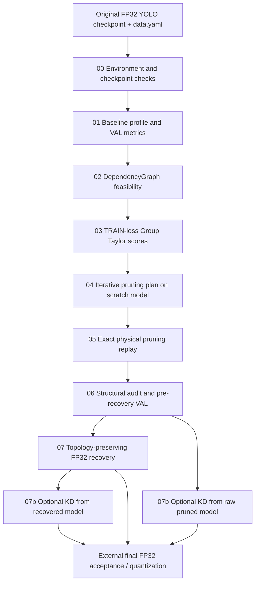

# YOLO Dependency-Aware Structured Pruning & FP32 Recovery

> **Installation guide, end-to-end execution workflow, validation contracts, and source-code reference**  
> **Scope:** structured output-channel pruning for **Ultralytics YOLOv8, YOLO11, and YOLO26 object-detection models**, followed by structural verification and optional FP32 accuracy recovery.  
> **Implementation:** PyTorch + Torch-Pruning dependency graphs, training-loss-based Group Taylor importance, physical channel removal, and topology-preserving fine-tuning.

This README documents the **actual Python sources included in this repository**. It explains what each stage checks or produces; it does **not** claim that every model variant, target compression ratio, dependency version, or training configuration has been successfully tested. The scripts for downstream Stage 08/09 acceptance or quantization are **not** part of this directory.

## Table of Contents

1. [Introduction and Supported Scope](#1-introduction-and-supported-scope)
2. [Pruning Method and Pipeline Overview](#2-pruning-method-and-pipeline-overview)
3. [Repository Structure](#3-repository-structure)
4. [Requirements and Installation](#4-requirements-and-installation)
5. [Preparing Models and Datasets](#5-preparing-models-and-datasets)
6. [Complete Execution Guide](#6-complete-execution-guide)
7. [Detailed Source File Reference](#7-detailed-source-file-reference)
8. [Generated Artifacts and Metrics](#8-generated-artifacts-and-metrics)
9. [Verification Gates, Provenance, and Statuses](#9-verification-gates-provenance-and-statuses)
10. [Pruning Strategy and Practical Tuning](#10-pruning-strategy-and-practical-tuning)
11. [Troubleshooting](#11-troubleshooting)
12. [Reproducibility, Git, and Limitations](#12-reproducibility-git-and-limitations)

---

## 1. Introduction and Supported Scope

The project implements a **dependency-aware structured pruning** workflow for YOLO detection networks. Unlike unstructured weight sparsification, it removes **actual convolutional output channels** and their dependent input channels, BatchNorm dimensions, and other coupled graph components. The resulting model is intended to have **fewer real parameters and fewer MACs**, rather than merely containing additional zero weights.

The workflow is deliberately conservative. Instead of guessing safe channel deletions from layer names alone, it uses **Torch-Pruning's `DependencyGraph` (DepGraph)** to discover propagation paths and validate them again before modifying a model.

### 1.1. Supported model families

| Family | Model task | Supported scales in shared metadata | Special considerations |
|---|---|---|---|
| YOLOv8 | Detection | `n`, `s`, `m`, `l` | Protect detection-head and split-sensitive dependencies |
| YOLO11 | Detection | `n`, `s`, `m`, `l` | Protect detection-head and split-sensitive dependencies |
| YOLO26 | Detection | `n`, `s`, `m`, `l` | End-to-end/one-to-one detection branches require conservative tracing and protection |

The supported family list is defined in `pruning_common.py`. A checkpoint must still pass the actual environment, identity, graph, and structural checks. **A recognized filename or model scale is not a guarantee of compatibility.**

### 1.2. What this repository provides

- Baseline FP32 profiling: parameter count, MACs, nominal FLOPs, inference timing, and validation metrics.
- DependencyGraph feasibility analysis with explicit **eligible** and **protected** pruning roots.
- **Group Taylor** importance estimated from real detection-loss gradients on the **training split**.
- Iterative, budget-aware pruning decisions validated on a **temporary in-memory model**.
- Replay of the exact approved decisions on the real model, followed by a reloadable `.pt` checkpoint.
- Independent structural checks, train-loss backward tests, fresh-process reload tests, and pre-recovery validation.
- FP32 recovery training that preserves the **physically pruned topology**.
- An optional, separate **attention-transfer Knowledge Distillation (KD)** recovery experiment.

### 1.3. What this repository does not provide

- No automatic QAT/PTQ, ONNX-to-TFLite conversion, or INT8 accuracy certification.
- No supplied Stage 08 final accuracy-acceptance script or Stage 09 QAT-readiness script.
- No guarantee of a particular compression rate, mAP retention, or speedup on deployment hardware.
- No production orchestration script that runs every stage automatically.
- No benchmark results bundled with the uploaded source code.

---

## 2. Pruning Method and Pipeline Overview



**Stages 00–04** perform preparation, analysis, and planning. Stage 04 can physically prune a **throwaway clone** to test its choices, but does not save a pruned source checkpoint. **Stage 05** applies and saves the permanent, physically pruned architecture. **Stage 06** independently verifies that architecture, while **Stage 07** restores detection quality without restoring removed channels.

### 2.1. Core concepts

**Dependency-aware channel pruning.** Deleting an output channel from one convolution may require deleting corresponding dimensions from downstream convolutions, normalization layers, residual/concat paths, and other dependent operations. DepGraph generates and validates these coupled edits.

**Group Taylor importance.** Stage 03 uses the real YOLO detection loss and records a dependency-coupled score based on the absolute first-order weight–gradient product:

\[
S \approx \mathbb{E}_{b}\left[\sum_{p\in\text{unique coupled parameters}}\left|w_p\frac{\partial (\mathcal L_b/B_b)}{\partial w_p}\right|\right].
\]

Here, \(B_b\) is the effective batch size in the per-image-loss calculation. The exact implementation also handles dependency mappings and deduplicates parameter contributions. **Small scores are a ranking heuristic, not permission to delete arbitrary channels.** Stage 04 must independently verify the selected channel block.

**Alignment and minimum width.** The default feasibility/planning policy uses `--channel-align 8` and `--min-channels 16`. These constraints apply to eligible/prunable feature channels, while sensitive or incompatible operations are protected. Do not interpret alignment as a guarantee about every layer in the entire network.

**Physical resource measurements.** Parameter reduction and MAC reduction are separate objectives. Stage 04 re-profiles each simulated candidate, and Stage 05 verifies the actual result; an 8-channel deletion does **not** necessarily yield a predictable percentage of total parameters or runtime.

---

## 3. Repository Structure

All names below are the **canonical filenames to use in Git** (without local duplicate suffixes such as `(1)`, `(2)`, or `(3)`). **These names matter:** several scripts import adjacent stages by their exact filenames.

```text

dependency-aware-pruning/
├── README.md
├── 00_check_environment.py
├── 01_profile_baseline.py
├── 02_analyze_pruning_graph.py
├── 03_collect_gradient_importance.py
├── 04_plan_structured_pruning.py
├── 05_apply_structured_pruning.py
├── 06_verify_pruned_model.py
├── 07_recover_fp32.py
├── 07b_recovery_fp32_kd.py
├── pruning_common.py
└── dataset_legacy_bridge.py
```

Suggested local-only assets (not included in this repository):

```text

project-root/
├── dependency-aware-pruning/      # The source files above
├── models/
│   └── best.pt                    # Your trained FP32 YOLO checkpoint
├── datasets/
│   └── head_and_person_dataset/
│       ├── data.yaml
│       ├── images/{train,val,test}/
│       └── labels/{train,val,test}/
└── runs/
    └── pruning/                   # Generated reports/checkpoints
```

**Important:** `04_plan_structured_pruning.py`, `05_apply_structured_pruning.py`, `07_recover_fp32.py`, and `07b_recovery_fp32_kd.py` use filename-based sibling imports; place all numbered scripts and helpers in the **same directory**, and do not rename them independently.

---

## 4. Requirements and Installation

### 4.1. System requirements

- **Python 3.10+**, suitable for modern type annotations used by the code.
- A compatible **PyTorch + torchvision** installation (CPU or NVIDIA CUDA).
- **Ultralytics** with API behavior compatible with these scripts.
- **Torch-Pruning** exposing `torch_pruning.DependencyGraph` and `torch_pruning.utils.count_ops_and_params`.
- Common numerical and dataset packages (`numpy`, `PyYAML`, etc.).
- A trained **FP32 YOLO detection `.pt`** checkpoint and YOLO-format dataset YAML.
- Enough RAM / VRAM for profiling, autograd tracing, true detection-loss backward, and iterative scratch-model pruning. Actual requirements depend on model scale and image size.

The pipeline is sensitive to dependency versions. The code **records** library versions in earlier stages and checks consistency between stages; it does not ship a lockfile or prescribe one universally validated package combination.

### 4.2. Create an isolated environment (Linux)

```bash
python3 -m venv .venv
source .venv/bin/activate
python -m pip install --upgrade pip

# First install a compatible PyTorch/torchvision build for your CUDA/CPU setup.
# Consult the official PyTorch installer for the correct platform-specific command.

python -m pip install \
  ultralytics torch-pruning numpy pyyaml pillow thop

# Optional: only if you use Stage 06's --export-onnx option.
python -m pip install onnx
```

If `torch` and `torchvision` are already installed in the correct environment, do not replace them blindly with a mismatched CUDA build.

### 4.3. Sanity checks

```bash
python - <<'PY'
import torch
import ultralytics
import torch_pruning as tp
import yaml

print('PyTorch:', torch.__version__)
print('Ultralytics:', ultralytics.__version__)
print('CUDA available:', torch.cuda.is_available())
print('GPU count:', torch.cuda.device_count())
print('Torch-Pruning profiler available:',
      callable(getattr(tp.utils, 'count_ops_and_params', None)))
print('PyYAML:', yaml.__version__)
PY
```

For the rest of this guide, commands are executed **from the directory containing the Python stage files**. Use `--device cpu` for a CPU run, or `--device 0` / `--device 1` for the selected CUDA GPU. CPU execution can be significantly slower, especially for gradient collection and scratch-model planning.

---

## 5. Preparing Models and Datasets

### 5.1. Source checkpoint

Use a local `best.pt` from a **trained detection model**. This checkpoint is the source of truth for the baseline and channel-ranking stages. Scripts are designed to avoid modifying the original file.

Ultralytics `.pt` files use pickle-based serialization: **only load checkpoints from trusted sources**.

### 5.2. Dataset format

Example `data.yaml` for a two-class head/person detector:

```yaml
path: /absolute/path/to/head_and_person_dataset
train: images/train
val: images/val
test: images/test
nc: 2
names:
  0: head
  1: person
```

Corresponding label files use the conventional YOLO detection format:

```text
class_id center_x center_y width height
```

Bounding-box coordinates are normalized to `[0, 1]`. Labels should mirror the corresponding image directories. Stage 00 requires valid `train` and `val` entries; the `test` entry is optional. The pruning pipeline does **not** use `test` images for training-loss importance or model selection.

### 5.3. Preserve the run contract

Stages 00–07 must agree on these **contract** options:

| Option | Example | Notes |
|---|---|---|
| `--model` | `/path/to/best.pt` | Use the same original checkpoint argument throughout stages 00–07 |
| `--data` | `/path/to/data.yaml` | Dataset YAML must stay consistent |
| `--output` | `/path/to/pruning_run` | A single run directory shared by stages 00–07 |
| `--imgsz` | `640` | Stage 01 and Stage 07 expect square input geometry |
| `--device` | `0` | Keep the same contract value across numbered stages |
| `--batch` | `8` | **Contract batch**; not necessarily the actual Stage 03/06/07 microbatch |
| `--workers` | `4` | **Contract workers**; recovery has a separate worker option |
| `--family` | `auto` | Can be overridden consistently if needed |
| `--expected-classes` | `2` | Optional, but when supplied must remain consistent |

**Do not** replace `--model` with the pruned `.pt` in Stage 05–07: those stages locate the pruned artifact using the shared run's lineage. The original model remains the `--model` contract argument.

The code hashes the checkpoint, dataset YAML, run gates, stage outputs, and selected source files. Dataset fingerprinting is based primarily on file path/size/mtime inventory (not always full content hashes). Changing the checkpoint, data, software environment, or upstream gate typically requires a **fresh run** or deliberate re-execution of affected stages.

---

## 6. Complete Execution Guide

This example uses a **YOLO26n head/person detector**, a nominal **45% real-parameter reduction target**, 8-channel alignment, and at least 16 channels in eligible layers. The target is an **experiment configuration, not an expected or guaranteed result**. Change paths, class count, and resource targets for your own project.

### 6.1. Set shared paths and options

```bash
cd /path/to/dependency-aware-pruning
source /path/to/.venv/bin/activate

export MODEL="/absolute/path/to/best.pt"
export DATA="/absolute/path/to/data.yaml"
export RUN="/absolute/path/to/runs/pruning/yolo26n_round1"

# Keep this argument block identical in stages 00–07.
COMMON=(
  --model "$MODEL"
  --data "$DATA"
  --output "$RUN"
  --imgsz 640
  --device 0
  --batch 8
  --workers 4
  --family auto
  --expected-classes 2
)
```

This is Bash syntax. The directory at `$RUN` can be created automatically by Stage 00. For another independent pruning experiment, use a **different** run directory rather than modifying a certified run in place.

### 6.2. Stage 00 — Check environment and inputs

```bash
python 00_check_environment.py "${COMMON[@]}"
```

Checks package/device readiness, dataset class contract, checkpoint identity, model family/task, finite FP32 forward, and initial provenance. Does not prune or train.

**Key output:** `stages/00/00_environment.json` and `gates/00_check_environment.json`.

### 6.3. Stage 01 — Establish the FP32 baseline

```bash
python 01_profile_baseline.py "${COMMON[@]}" \
  --conf 0.001 --iou 0.7 --max-det 1000 \
  --profile-repeats 2 --warmup-iters 2 --bench-iters 5
```

Measures real parameter count, MACs, nominal FLOPs, module inventory, approximate forward latency, and full validation metrics. Records per-class precision/recall/AP and the baseline validation settings.

**Key outputs:** `01_profile.json`, `01_baseline_val.json`, `01_baseline_per_class.csv`.

For YOLO26, use `--nms-free` **only if** you intentionally want the one-to-one/NMS-free validation mode. Do not change that evaluation mode halfway through the experiment.

### 6.4. Stage 02 — Analyze the pruning graph

```bash
python 02_analyze_pruning_graph.py "${COMMON[@]}" \
  --channel-align 8 \
  --min-channels 16 \
  --trace-mode train
```

Builds the autograd-based DepGraph, finds output-channel pruning roots, protects sensitive paths (including detection heads, attention, and static split/chunk dependencies), and probes candidate groups for safety.

**Key outputs:** `02_graph.json`, `02_eligible_groups.csv`, `02_protected_groups.csv`.

A **Stage 02 PASS means conservative feasibility probes succeeded**. It does *not* certify every possible combination of future channel deletions.

### 6.5. Stage 03 — Compute Group Taylor importance

```bash
python 03_collect_gradient_importance.py "${COMMON[@]}" \
  --gradient-batches 64 \
  --gradient-batch-size 2 \
  --seed 42
```

Uses actual **TRAIN** batches and the model's detection loss to accumulate gradient-based, dependency-coupled channel scores. There is no optimizer update or checkpoint mutation at this stage. `--gradient-batch-size` is an independent gradient microbatch limit and can be smaller than the fixed `--batch` contract.

**Key outputs:** `03_importance.json`, `03_importance.npz`, `03_channel_scores.csv`, `03_grad_log.csv`, and `03_unscored_channels.csv`.

By default, Stage 03 refuses incomplete score coverage for eligible roots. The opt-in `--allow-unscored-roots` conservatively excludes unscoreable roots rather than inventing scores.

### 6.6. Stage 04 — Plan structured pruning

```bash
python 04_plan_structured_pruning.py "${COMMON[@]}" \
  --method group-taylor \
  --target-metric params \
  --target-reduction 0.45 \
  --target-tolerance 0.005 \
  --channel-align 8 \
  --min-channels 16 \
  --iterative-steps 5 \
  --max-decisions 64 \
  --ranking sensitivity \
  --candidate-mode hybrid \
  --allow-partial-target
```

Ranks safe channel blocks, rebuilds exact dependencies for candidate decisions, **physically prunes temporary model clones**, and measures parameter/MAC savings before accepting each proposed action. It records `original_indices` and `current_indices` so Stage 05 can replay the precise decision order.

**Key outputs:** `04_plan.json` and `04_channel_changes.csv`.

`--allow-partial-target` permits a **PASS** when at least one valid plan exists but the requested resource reduction was not achieved. Inspect the plan's `target_status` and actual projected reductions; **PASS does not imply 45% compression**.

### 6.7. Stage 05 — Apply physical pruning

```bash
python 05_apply_structured_pruning.py "${COMMON[@]}" \
  --channel-align 8 \
  --min-channels 16 \
  --profile-every 1
```

Replays the **exact** Stage 04 decisions, rebuilds DepGraph as required, checks dependent channel mappings and actual structural/resource changes, and writes a reloadable Ultralytics checkpoint. It does **not** re-rank channels or choose a different prune plan.

**Key checkpoint:**

```text
$RUN/stages/05/05_pruned_raw.pt
```

**Additional outputs:** `05_report.json`, `05_graph_signature.json`, `05_pruning_trace.csv`.

This is the first stage that saves the **persistently pruned model**. The original source `.pt` should remain unchanged.

### 6.8. Stage 06 — Independently verify the pruned model

```bash
python 06_verify_pruned_model.py "${COMMON[@]}" \
  --backward-batches 2 \
  --backward-batch-size 2 \
  --val-max-images 256 \
  --val-seed 42 \
  --compare-source-val \
  --recovery-map-drop 0.02
```

Independently audits lineage and physical Conv/BN dimensions, reconstructs the graph, performs a **real TRAIN detection-loss backward pass**, reloads the `.pt` in a **fresh Python process**, and validates original/pruned checkpoints on the **same VAL subset** by default.

**Key outputs:** `06_graph_audit.json`, `06_reload_receipt.json`, `06_pre_recovery_val.json`, `06_report.json`.

**Interpret the results correctly:** Stage 06 can have a **structural PASS** while `accuracy_status` is `RECOVERY_NEEDED`. That means the pruned graph works, but the measured mAP drop is larger than the configured tolerance. It is **not** a structural error.

For full validation instead of a smoke subset, set `--val-max-images 0`. For an optional ONNX export + checker, add `--export-onnx` (and install `onnx`). ONNX export is **not** enabled by default.

### 6.9. Stage 07 — Recover FP32 accuracy

```bash
python 07_recover_fp32.py "${COMMON[@]}" \
  --recovery-epochs 30 \
  --recovery-batch 4 \
  --recovery-workers 2 \
  --optimizer AdamW \
  --lr0 0.0002 \
  --lrf 0.05 \
  --weight-decay 0.0005 \
  --patience 15 \
  --val-subset full \
  --no-amp
```

Fine-tunes the **already pruned architecture**. The script uses the physically pruned `nn.Module` inside an Ultralytics `DetectionTrainer` and explicitly blocks unwanted model reconstruction from the original YAML. It writes FP32 EMA-derived best/last model snapshots and verifies that parameters and Conv/BN shapes stay physically pruned.

**Recovered checkpoints:**

```text
$RUN/weights/pruned_recovered_best.pt
$RUN/weights/pruned_recovered_last.pt
```

**Additional outputs:** `07_report.json`, `07_results.csv`, `07_epoch_checkpoints.json`, plus fresh-process reload receipts.

The default `--val-subset full` selects the recovered checkpoint on the full validation split. `--val-subset stage06` is for faster exploratory recovery on Stage 06's fixed subset; its selected checkpoint should subsequently be evaluated on full VAL. **Accuracy acceptance remains a separate task, not a claim made by Stage 07 PASS.**

### 6.10. Stage 07b — Optional KD recovery experiment

`07b_recovery_fp32_kd.py` is a **separate experimental branch**, not a mandatory predecessor of Stage 07 or a replacement for final accuracy acceptance. It can initialize from either the Stage 05 raw checkpoint or the Stage 07 recovered-best checkpoint, provided the parent run passes the required lineage checks.

Example starting from Stage 07's best checkpoint:

```bash
python 07b_recovery_fp32_kd.py \
  --parent-round "$RUN" \
  --student "$RUN/weights/pruned_recovered_best.pt" \
  --teacher "$MODEL" \
  --data "$DATA" \
  --output "${RUN}_kd" \
  --epochs 30 \
  --batch 4 \
  --workers 4 \
  --kd-weight 0.2 \
  --lr0 0.0001 \
  --lrf 0.1 \
  --device 0
```

The teacher must have the **same class mapping** as the student. The KD mechanism transfers **spatial attention information from three detection-head input feature maps**; it does not introduce trainable projection layers or extra inference parameters. The output reports KD loss, validation metrics, and topology invariance.

**Important constraints of the current implementation:** Stage 07b uses **640×640** imagery and hard-codes some internally constructed Stage 07 configuration values (`--batch 8`, `--workers 8`). It also refuses to overwrite an existing KD output directory. Run it only with a compatible parent experiment and inspect the results independently.

---

## 7. Detailed Source File Reference

| File | Purpose | Main input(s) | Main result |
|---|---|---|---|
| `00_check_environment.py` | Environment/dataset/checkpoint gate | Original `.pt`, YAML | Initial PASS gate and provenance |
| `01_profile_baseline.py` | FP32 baseline and validation | Stage 00 PASS | Params, MACs, AP, latency metrics |
| `02_analyze_pruning_graph.py` | DepGraph feasibility analysis | Stages 00–01 PASS | Eligible/protected roots and safe probes |
| `03_collect_gradient_importance.py` | Group Taylor gradient scoring | Stage 02 graph + TRAIN data | Per-channel coupled importance |
| `04_plan_structured_pruning.py` | Candidate selection/scratch simulation | Graph + importance | Exact, ordered pruning plan |
| `05_apply_structured_pruning.py` | Apply real structured pruning | Stage 04 plan | Reloadable physically pruned `.pt` |
| `06_verify_pruned_model.py` | Independent model audit | Stage 05 checkpoint | Structural audit + VAL comparison |
| `07_recover_fp32.py` | Topology-preserving fine-tuning | Verified pruned `.pt` | FP32 recovered best/last `.pt` |
| `07b_recovery_fp32_kd.py` | Optional teacher/student KD | Parent run, teacher, student | KD-trained best/last + report |
| `pruning_common.py` | Shared IO, contracts, model/dataset metadata | Imported by stages | Helpers for hashing, gates, logs |
| `dataset_legacy_bridge.py` | Explicit legacy dataset-inventory migration | Historical fingerprint + cache context | Bounded migration records for 05/06 |

### 7.1. `00_check_environment.py`

Performs initial argument validation, package and CUDA checks, `data.yaml` parsing, model-family discovery, task/class compatibility checks, initial dataset inventory, checkpoint SHA256 recording, and a finite FP32 forward test. Has no optimizer, pruning, or checkpoint-writing side effects.

### 7.2. `01_profile_baseline.py`

Measures unpruned network resource costs using Torch-Pruning's profiler. Records layer/module inventory, nominal FLOPs (using **2 FLOPs per MAC**), and a raw-forward latency measurement. Separately invokes Ultralytics validation and reports overall/per-class metrics. Uses VAL, **not TEST**.

### 7.3. `02_analyze_pruning_graph.py`

Traces the training-mode detection graph using DepGraph. Classifies candidate pruning roots as eligible or protected; explicitly guards detection-head, attention, and split/chunk-sensitive paths. Stores at least one checked group-level feasibility probe when successful. The code itself warns that **YOLO26's detached one-to-one branch is not fully exposed by the standard autograd trace**; the detection head remains protected.

### 7.4. `03_collect_gradient_importance.py`

Runs real forward/backward computations over distinct training batches. Accumulates first-order gradient sensitivity, resolves dependent parameter masks, and writes per-channel scores plus a gradient-collection audit log. `03_unscored_channels.csv` makes excluded/incomplete mappings visible instead of silently giving them artificially low importance.

### 7.5. `04_plan_structured_pruning.py`

Uses the Stage 02 graph and Stage 03 importance scores to select aligned channel blocks. Each accepted decision is tested by creating a model clone, performing **real in-memory structural pruning**, running a forward pass, and measuring resulting resource counts. The planner intentionally restricts modifications of the same parameter-bearing module by different pruning roots within one plan to avoid stale cross-root mappings.

Stage 04 supports independent targets for `channels`, `params`, or `macs`, plus sensitivity-first or resource-efficiency ranking.

### 7.6. `05_apply_structured_pruning.py`

Consumes the approved ordered plan without making new importance decisions. Replays original/current indices and exact dependency effects, checks the actual Conv/BN dimensions and resource reduction, and saves `05_pruned_raw.pt` as an Ultralytics-compatible checkpoint. Optional in-process reload validation is enabled by default; Stage 06 adds an independent fresh-process check.

### 7.7. `06_verify_pruned_model.py`

Checks physical topology, the full pruning trace, finite weights/buffers, train/eval forward behavior, real detection-loss backward, and reload compatibility in an independent process. Its smoke validation uses the same VAL sample for original and pruned checkpoints. Structural success and accuracy recovery requirements are intentionally separate.

### 7.8. `07_recover_fp32.py`

Retrains the same pruned model using the native detection trainer without silently reconstructing the original unpruned YAML architecture. Uses validation fitness for checkpoint selection, writes genuine FP32 snapshots, and checks that both best and last reload with their channel topology unchanged. **This stage is recovery, not another pruning stage.**

### 7.9. `07b_recovery_fp32_kd.py`

Implements parameter-free spatial attention transfer using hooks on student and teacher detection-head input pyramids. Reuses Stage 07's topology-preserving trainer, verifies the same three feature resolutions and class map, and records KD-specific metrics. It produces a separate experimental result directory and does not constitute a Stage 08 accuracy gate.

### 7.10. `pruning_common.py`

Contains the shared dataset parser, checkpoint/file SHA256 helpers, deterministic JSON writing, stage-gate bookkeeping, environment-version snapshots, model-family metadata, device selection, tensor-output inspection, and run-contract construction. It is an infrastructure helper rather than a pruning algorithm.

### 7.11. `dataset_legacy_bridge.py`

Provides an explicit migration/verification mechanism for certain **historical Stage 00 stat-based dataset inventories**. In a narrowly defined legacy situation, it records current non-cache file **content hashes** and an acknowledged provenance limitation; it does **not** retroactively prove that old training images or labels were unchanged. Most fresh runs should never need `--legacy-cache-path` or `--acknowledge-unverifiable-legacy-fingerprint`.

---

## 8. Generated Artifacts and Metrics

A normal run uses this output layout (some files are optional, and some appear only on successful stages):

```text
$RUN/
├── gates/
│   ├── 00_check_environment.json
│   ├── 01_profile_baseline.json
│   ├── 02_analyze_pruning_graph.json
│   ├── 03_collect_gradient_importance.json
│   ├── 04_plan_structured_pruning.json
│   ├── 05_apply_structured_pruning.json
│   ├── 06_verify_pruned_model.json
│   └── 07_recover_fp32.json
├── logs/
│   └── <stage>_<name>.log
├── stages/
│   ├── 00/
│   │   └── 00_environment.json
│   ├── 01/
│   │   ├── 01_profile.json
│   │   ├── 01_baseline_graph.json
│   │   ├── 01_baseline_val.json
│   │   └── 01_baseline_per_class.csv
│   ├── 02/
│   │   ├── 02_graph.json
│   │   ├── 02_eligible_groups.csv
│   │   ├── 02_protected_groups.csv
│   │   └── 02_report.json
│   ├── 03/
│   │   ├── 03_importance.json
│   │   ├── 03_importance.npz
│   │   ├── 03_channel_scores.csv
│   │   ├── 03_grad_log.csv
│   │   └── 03_unscored_channels.csv
│   ├── 04/
│   │   ├── 04_plan.json
│   │   └── 04_channel_changes.csv
│   ├── 05/
│   │   ├── 05_pruned_raw.pt
│   │   ├── 05_report.json
│   │   ├── 05_graph_signature.json
│   │   └── 05_pruning_trace.csv
│   ├── 06/
│   │   ├── 06_report.json
│   │   ├── 06_graph_audit.json
│   │   ├── 06_reload_receipt.json
│   │   ├── 06_pre_recovery_val.json
│   │   ├── 06_backward_log.csv
│   │   ├── 06_val_subset.txt
│   │   └── 06_smoke_val.yaml
│   └── 07/
│       ├── 07_report.json
│       ├── 07_results.csv
│       └── 07_epoch_checkpoints.json
└── weights/
    ├── pruned_recovered_best.pt
    └── pruned_recovered_last.pt
```

The optional 07b experiment instead writes its own `stages/07b/07b_report.json`, `gates/07b_recovery_fp32_kd.json`, logs, and recovered checkpoints under its separate output directory.

### 8.1. Key measurements

| Measurement | Meaning | Important caveat |
|---|---|---|
| Parameter count | Number of actual model parameters | Physical pruning, not merely zero-valued weights |
| MACs / GMACs | Multiply–accumulate operations under the profiler's input shape | Not equal to measured hardware latency |
| Nominal FLOPs | Approx. `2 × MACs` in Stage 01 | Profiler may omit some elementwise operations |
| Precision / Recall / F1 | Detection performance, overall and per class | Depends on validation settings and data |
| AP50 / AP75 / mAP50–95 | Detection accuracy at different IoU criteria | Keep dataset and validation mode consistent |
| Group Taylor score | Estimated sensitivity of dependent weight/channel group | Heuristic for planning, not direct mAP-drop prediction |
| Target reduction | Requested fraction removed in Stage 04 | `target_metric` changes its denominator |
| Actual reduction | Real resource changes from the simulated and physical model | Verify independently; may undershoot target |
| Recovery mAP | Validation quality after Stage 07 or 07b | Selection on VAL is not test-set evaluation |

### 8.2. Inspect a run quickly

```bash
python - "$RUN" <<'PY'
import json, sys
from pathlib import Path

root = Path(sys.argv[1])
for gate in sorted((root / 'gates').glob('*.json')):
    data = json.loads(gate.read_text(encoding='utf-8'))
    print(f"{gate.name:38s} {data.get('status', 'UNKNOWN')}")

for file in (
    'stages/04/04_plan.json',
    'stages/05/05_report.json',
    'stages/06/06_report.json',
    'stages/07/07_report.json',
):
    p = root / file
    if p.is_file():
        print(f'\n{file}: {p}')
PY
```

Prefer reading stage-specific reports for the exact `target_status`, compression measurements, and accuracy results instead of interpreting a gate's `PASS` value as a performance benchmark.

---

## 9. Verification Gates, Provenance, and Statuses

### 9.1. Gate convention

Stages 00–07 use JSON **gates** under `$RUN/gates/`. A normal gate records the stage name, `PASS`/`FAIL`, required checks, errors, warnings, provenance, and artifact paths. Later stages reject missing, failed, or stale prerequisites.

The `--overwrite` option is deliberately consequential: upstream re-runs invalidate corresponding downstream gates. **Avoid using `--overwrite` merely to skip a failed dependency or to silently reuse stale reports.** Prefer a new run directory when changing important experimental settings.

### 9.2. Status interpretation

| Status / field | Interpretation |
|---|---|
| `PASS` | The mandatory checks defined for that specific stage passed |
| `FAIL` | One or more required checks failed; inspect the gate, log, and traceback |
| `TARGET_REACHED` | Stage 04 achieved the requested target within its tolerance |
| `PARTIAL_TARGET` | Stage 04 produced a plan but undershot the target; PASS requires explicit allowance |
| `SIMULATED_VALID` | One Stage 04 candidate passed scratch-model checks |
| `PHYSICAL_PRUNE_VERIFIED` | One Stage 05 physical pruning action passed replay verification |
| `STRUCTURALLY_VERIFIED` | Stage 06's model structure and required checks were verified |
| `RECOVERY_NEEDED` | Stage 06 measured a larger-than-allowed mAP drop; **not** a structural failure |
| `WITHIN_SMOKE_TOLERANCE` | Stage 06's sampled validation drop stayed within the configured threshold |
| `NOT_ASSESSED_NO_SAME_SUBSET_BASELINE` | Stage 06 lacks a paired baseline for that accuracy comparison |
| `DEFERRED_TO_STAGE08` | Stage 07 does not certify final FP32 accuracy acceptance |
| `UNVERIFIED_STAGE09_REQUIRED` | Stage 07 does not certify readiness for a separate QAT pipeline |

**No gate here should be presented as proof of deployment speedup or downstream INT8 compatibility.** A structural reduction in MACs can coexist with little latency gain on a particular target device.

### 9.3. Provenance protections

The pipeline records and validates combinations of:

- Original checkpoint path and SHA256.
- `data.yaml`, class map, dataset inventory, and split information.
- The shared model/dataset/image-size/device/batch/workers/family contract.
- Dependency versions and upstream gate/artifact hashes.
- Stage 02/03 source and intermediate results where required.
- Exact Stage 04 channel indices and Stage 05 replay/audit records.
- Shape signatures and fresh-process reload receipts.

The Stage 00 dataset inventory is **not a fully cryptographic content snapshot for every file**. Do not claim that this mechanism detects every possible content mutation that preserves file size and timestamps.

---

## 10. Pruning Strategy and Practical Tuning

### 10.1. Choosing a target

A 45% target should normally be described as **45% of total physical model parameters removed** only when `--target-metric params` is selected. The `channels` and `macs` targets have different meanings. `--target-reduction 0.45` does not enforce exact 45% removal when safe actions or limits prevent reaching it.

Useful Stage 04 options:

| Argument | Default | Behavior |
|---|---|---|
| `--target-metric` | `channels` | Choose `channels`, `params`, or `macs` |
| `--target-reduction` | `0.10` | Fraction of the selected metric to remove |
| `--target-tolerance` | `0.005` | Allowed target shortfall / overshoot consideration |
| `--channel-align` | `8` | Eligible channel-block alignment; must match Stage 02 |
| `--min-channels` | `16` | Minimum eligible output width; must match Stage 02 |
| `--iterative-steps` | `5` | Number of recorded iterative pruning stages |
| `--max-decisions` | `64` | Cap on accepted pruning actions |
| `--ranking` | `sensitivity` | `sensitivity` or `efficiency` |
| `--candidate-mode` | `hybrid` | `hybrid` or contiguous-only candidate search |
| `--allow-partial-target` | Off | Permit a validated plan below the requested target |
| `--max-original-conv-prune-ratio` | `1.0` | Optional cumulative per-Conv pruning cap |
| `--balance-strength` | `0.0` | Optional penalty against concentrating pruning in one root |
| `--normalize-sensitivity` | Off | Optional root-score normalization |

**Cumulative cap:** when `--max-original-conv-prune-ratio` is less than `1.0`, Stage 04 also requires `--reference-model` so the cap can be checked against a reference checkpoint. This is particularly relevant for experiments with repeated pruning rounds.

### 10.2. Accuracy-first versus efficiency-first ranking

- **Sensitivity-first** (`--ranking sensitivity`) prefers channel groups with lower Taylor sensitivity. This is a reasonable starting point when mAP retention has priority.
- **Efficiency-first** (`--ranking efficiency`) also considers expected resource savings, potentially prioritizing reductions that offer more compression per unit of sensitivity.
- **Hybrid candidate mode** may consider noncontiguous low-score channel selections if exact DepGraph checks approve; otherwise it still enforces valid dependencies and alignment.

The “best” setting is empirical: compare **pruned parameter count, MACs, pre-recovery mAP, post-recovery mAP, and measured inference time** under identical evaluation settings.

### 10.3. Multiple rounds and iterative pruning

`--iterative-steps` records decisions as logical stages within **one plan**. It is not equivalent to automatically running multiple complete **prune → recover → prune** cycles.

For a separate second-round experiment, begin with a **new source checkpoint and new run directory**, rerun all required gates, and carefully define what the compression ratio is relative to (current round versus original baseline). Do not reuse stale gate files or assume the first round's channel indices remain valid in a new topology.

### 10.4. Recovery and KD

FP32 recovery may improve mAP after pruning, but it cannot guarantee restoration to the original baseline. KD is an **optional experiment** that transfers teacher information to the physically smaller student; it should be compared against a non-KD recovery run at identical architecture, dataset, and validation settings.

---

## 11. Troubleshooting

| Symptom | Possible cause | What to check |
|---|---|---|
| `ModuleNotFoundError: pruning_common` | Files are not colocated / renamed incorrectly | Keep canonical script filenames and shared helpers in one directory |
| Missing predecessor gate | Earlier stage did not PASS, or output directory differs | Run stages 00–07 in order with the same `--output` |
| Contract/hash mismatch | Changed model path, dataset, CLI options, environment, or upstream artifacts | Compare gate provenance; use a fresh run when appropriate |
| `CUDA out of memory` | DepGraph tracing, gradient batches, scratch cloning, or validation needs too much VRAM | Close competing jobs; reduce Stage 03 microbatch, Stage 06 backward/VAL batch, or Stage 07 recovery batch; use an appropriate GPU |
| Unsupported model family | Metadata does not identify one of the supported detector families | Inspect source `.pt`; use consistent `--family` only when correct |
| Stage 02 has no eligible groups | Conservative protection and group constraints reject candidates | Inspect `02_protected_groups.csv`; do not blindly disable protective flags |
| Stage 03 incomplete / zero scores | Insufficient valid TRAIN gradients or unscoreable dependency maps | Inspect gradient log, labels, `03_unscored_channels.csv`, and gradient settings |
| Stage 04 `PARTIAL_TARGET` | No more safe actions, candidate limit, or resource policy | Inspect `04_plan.json`; consider a lower target or explicit partial-target allowance |
| Stage 05 replay mismatch | Selected indices/DepGraph changed or plan/source mismatch | Do not force replay; verify plan, hashes, source versions, and stages 02–04 |
| Stage 06 `RECOVERY_NEEDED` | Accuracy dropped before retraining | Proceed with Stage 07; it does **not** mean the graph failed |
| Stage 07 reconstructs original architecture | Native `YOLO(pruned.pt).train()` can rebuild from model YAML | Use provided Stage 07 trainer path; verify physical shapes in saved checkpoints |
| KD teacher/student mismatch | Different class mapping or incompatible feature resolutions | Use a matching original teacher; inspect 07b feature and class checks |
| Unexpected `.cache` lineage issues | Dataset metadata differs from earlier recorded run | Prefer a fresh run; legacy migration is narrow and requires explicit acknowledgement |
| ONNX export fails | Optional exporter/dependency mismatch | First verify Stage 06 without `--export-onnx`; check ONNX installation and model support |

### 11.1. Check a failing stage

```bash
# Example: Stage 05 failure
cat "$RUN/gates/05_apply_structured_pruning.json"
tail -n 100 "$RUN/logs/05_apply_structured_pruning.log"

# Traceback, if generated:
cat "$RUN/stages/05/05_error_traceback.txt"
```

Never edit gate files by hand to change a `FAIL` to `PASS`. A gate is a record of executed checks, not a configuration toggle.

---

## 12. Reproducibility, Git, and Limitations

### 12.1. Git best practices

Commit the **source scripts and this README**, and consider adding a small environment-lock/requirements file once a known-good setup has been validated. Avoid committing large models, datasets, transient traces, logs, and training output directories in normal Git history.

Suggested `.gitignore` entries (adjust them to the actual repository layout):

```gitignore
# Python
__pycache__/
*.py[cod]
.venv/
venv/
.pytest_cache/

# Training and pruning outputs
runs/
weights/
logs/
wandb/

# Large model, data, and intermediate artifacts
*.pt
*.pth
*.onnx
*.tflite
*.npz
*.cache

# Local environment / editor
.env
.vscode/
.idea/
.DS_Store
```

If distributing checkpoints is required, use a deliberate artifact-release mechanism (such as Git LFS or release assets) and check applicable size and license restrictions. **Do not publish private datasets, credentials, or third-party checkpoint files without permission.**

### 12.2. Reproducibility checklist

- Record checkpoint SHA256, model family/scale, exact `data.yaml`, and number of classes.
- Record Python/PyTorch/Ultralytics/Torch-Pruning/CUDA versions.
- Keep exact `--imgsz`, confidence threshold, IoU threshold, `max_det`, and NMS mode for fair validation.
- Record Stage 03 gradient batch count, microbatch, and seed.
- Record Stage 04 objective, target, ranking, alignment, minimum width, and partial-target policy.
- Compare source/pruned/recovered models on the **same VAL split and evaluation protocol**.
- Confirm physical Conv/BN shapes after Stage 05 and after Stage 07/07b.
- Treat inference-time results as hardware-specific; test on the intended deployment device.
- Use a new run folder when changing fundamental inputs or repeating an independent experiment.

### 12.3. Known limitations

1. **Architecture-sensitive code.** Ultralytics and Torch-Pruning internals can change; an environment that imports successfully may still require adaptation for a different model release.
2. **Conservative eligibility.** Attention, split/chunk-sensitive paths, and detection heads are protected. This improves safety but may limit achievable compression.
3. **Stage 02 is only a feasibility test.** Exact plans must still pass scratch simulation, physical replay, independent reload, and true detection-loss backward.
4. **Dependency fingerprints are not uniformly content-based.** The original Stage 00 stat inventory does not cryptographically verify all dataset bytes; the legacy bridge is an explicitly bounded workaround, not historical proof.
5. **Pruning target is not an accuracy constraint.** No stage automatically enforces a fixed allowable post-recovery mAP loss relative to the original baseline.
6. **Stage 06 smoke VAL is not final acceptance.** The default subset is 256 images and its `RECOVERY_NEEDED` flag is a diagnosis, not a graph verdict.
7. **Stage 07/07b are not quantization tools.** Final FP32 acceptance, QAT/PTQ, INT8 export, and deployment testing must be performed separately.
8. **07b is experimental.** It assumes a three-level detection-head feature pyramid and contains fixed 640×640 / internal contract settings.
9. **Performance depends on the hardware and backend.** Fewer MACs or parameters do not automatically translate into equivalent wall-clock speedup.
10. **No claim of full integration testing.** This README was prepared from the supplied source files; no end-to-end training, pruning, recovery, or export run was executed as part of preparing the documentation.

### 12.4. Background references

- [Ultralytics documentation](https://docs.ultralytics.com/)
- [Torch-Pruning repository and DepGraph documentation](https://github.com/VainF/Torch-Pruning)
- [PyTorch documentation](https://pytorch.org/docs/stable/index.html)
- [PyTorch installation selector](https://pytorch.org/get-started/locally/)

---

**Summary:** Use **Stages 00–04** to validate the original model and build a dependency-safe pruning plan, **Stage 05** to create the physically smaller checkpoint, **Stage 06** to audit the modified model, and **Stage 07** (optionally **07b**) to recover FP32 detection quality. Always report **actual** parameter/MAC reductions and validation metrics rather than treating a target or a stage gate as a measured result.
# dependency-aware-pruning
